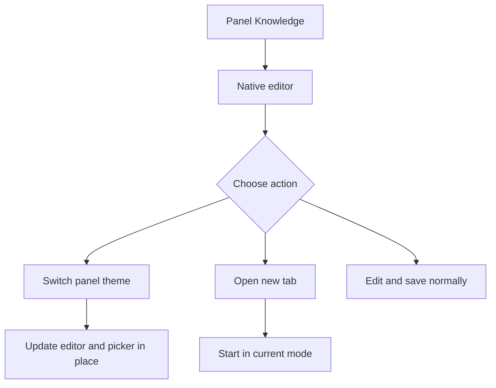
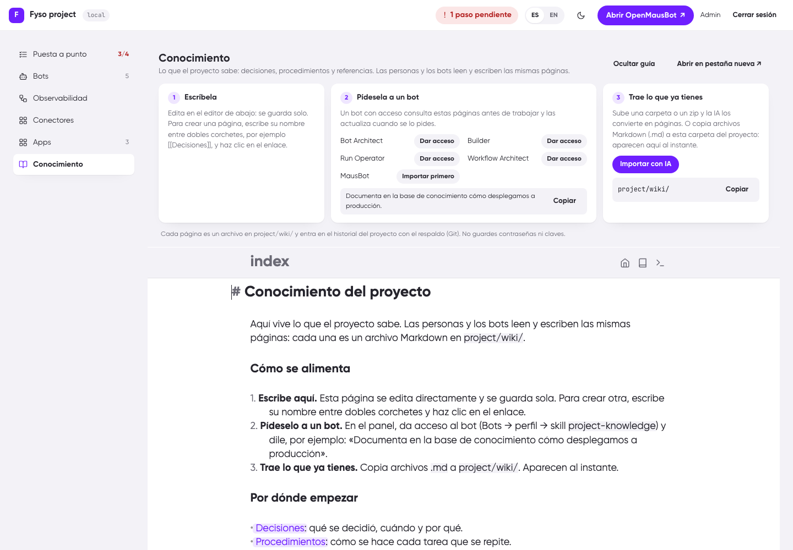
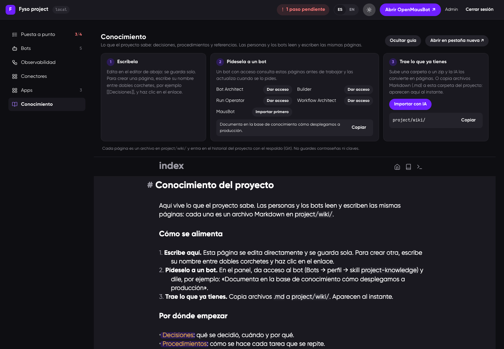
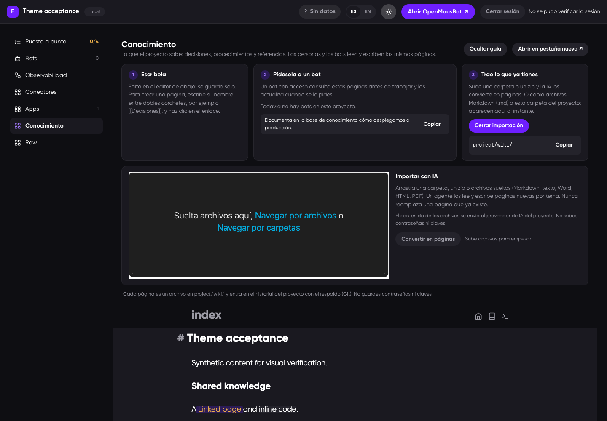
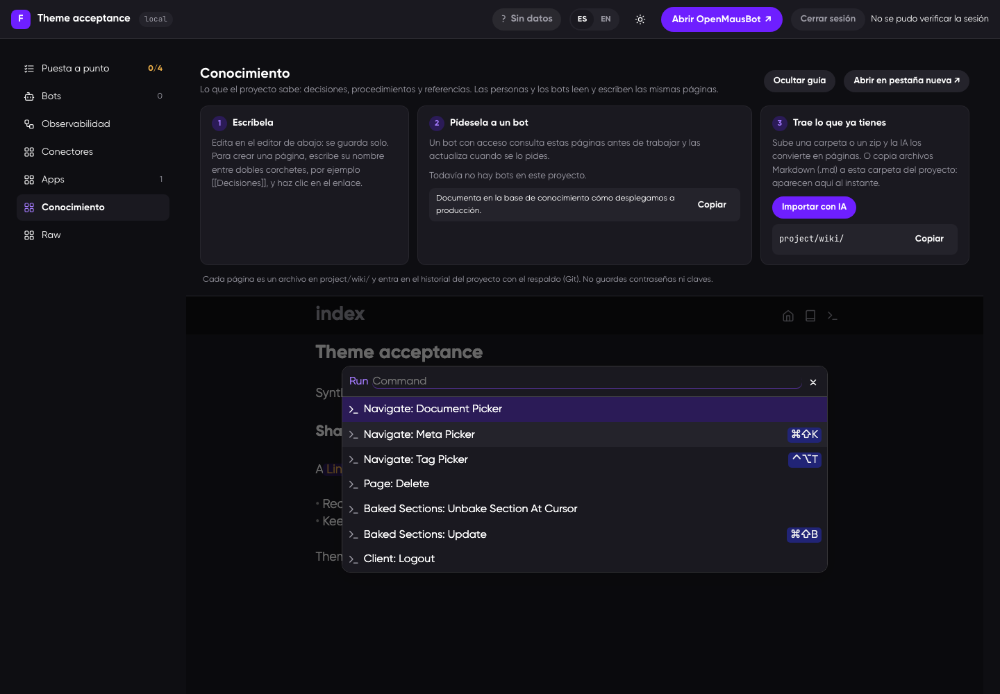
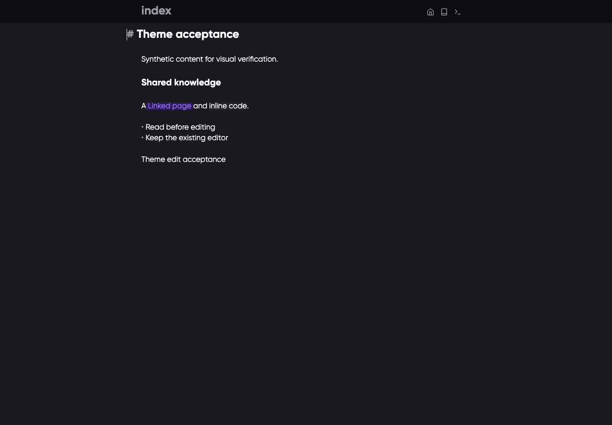
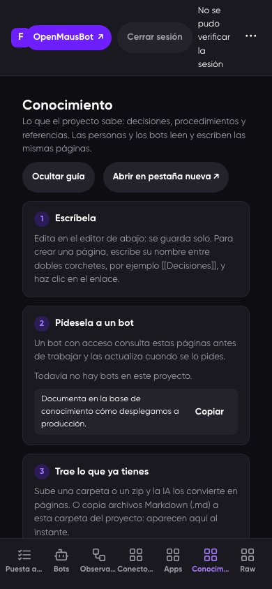

# Panel-aligned SilverBullet theme

## Overview

The real SilverBullet 2.12.1 editor now uses the Fyso panel's palette and Gilroy
font. Light/dark changes preserve the editor and the upload picker. Automated
Chromium acceptance covers both a synthetic panel-data fixture with real services
and a generated full stack with native web login. No AI-provider calls are made.

## Contents

- [User flow](#user-flow)
- [Acceptance matrix](#acceptance-matrix)
- [Visual evidence](#visual-evidence)
- [Automated validation](#automated-validation)
- [Scope and limitations](#scope-and-limitations)
- [Handoff signals](#handoff-signals)

## User flow

Open Knowledge from the panel. The wiki keeps its native editor and reads the
same files. Changing the panel's theme updates the embedded editor and Uppy
without recreating either window. Opening the wiki in a new tab carries the
current mode; subsequent native mode changes control that independent window.
Plain HTML extension pages without the SDK retain URL-based theme reloads.



## Acceptance matrix

| Scenario | Expected result | Status | Evidence |
|---|---|---|---|
| Light and dark | Palette and Gilroy match panel | ✅ | [Live stack](#live-stack) |
| Theme switch | Same editor window retained | ✅ | Both browser scripts assert a retained window marker |
| Upload picker | Same window/batch context, native Uppy theme updates | ✅ | [Import](#import) |
| Native controls | Edit saved to file; command picker works | ✅ | [Commands](#commands) |
| New tab | Starts in panel mode | ✅ | [Standalone](#standalone) |
| Mobile | Editor fits viewport | ✅ | [Mobile](#mobile) |
| Message boundary | Foreign origin and wrong source rejected | ✅ | `theme-browser.cjs` |
| Assets | CSS, JS and fonts 200 with login, 401 in the Basic-auth fixture; login redirect in live stack | ✅ | Both browser scripts |
| Non-SDK page | Existing URL/reload contract preserved | ✅ | `theme-browser.cjs` |

## Visual evidence

### Live stack

<details><summary>Native login and actual generated panel configuration</summary>

Automated Chromium: the actual panel and SilverBullet share the light palette.
<p align="center"></p>

Automated Chromium: switching to dark keeps the native editor window and aligns its surface and typography.
<p align="center"></p>

</details>

### Import

<details><summary>Uppy changes mode without losing its window</summary>

Automated local fixture: the existing Uppy dashboard uses dark mode; the test asserts its window marker survives the switch. No upload or AI import is started.
<p align="center"></p>

</details>

### Commands

<details><summary>Native command palette</summary>

Automated local fixture: SilverBullet's own command palette remains available and uses the aligned surfaces and accent.
<p align="center"></p>

</details>

### Standalone

<details><summary>Full-window editor</summary>

Automated local fixture: opening a new tab carries the panel's current dark mode.
<p align="center"></p>

</details>

### Mobile

<details><summary>Narrow viewport</summary>

Automated local fixture at 390 × 844: the native editor fits the available width.
<p align="center"></p>

</details>

## Automated validation

Run on macOS ARM64 with pinned SilverBullet 2.12.1 and the project's existing
Playwright/Chromium installation. One browser process per script, no retries.
The companion framework checkout must have its panel built.

```sh
FYSO_TEST_FRAMEWORK_ROOT=<framework-checkout> node tests/theme-browser.cjs
FYSO_TEST_WEB_PANEL=<isolated-panel-url> FYSO_TEST_WEB_PASSWORD_FILE=<private-test-file> node tests/theme-live-browser.cjs
node --test tests/import.test.cjs
```

Run the first command through a generated project's `mise exec --` environment
so Caddy, SilverBullet and the pinned Uppy packages are available. Make the
existing Playwright installation resolvable through Node's normal module lookup
or `NODE_PATH`; this extension does not add a browser runtime dependency.

Results: both browser acceptance scripts passed; 5 import tests passed. The
companion framework build/typecheck and 23 targeted unit tests passed. A project
generated with both branches passed `mise run doctor` including the extension.
CSS, JS and font requests returned 200 authenticated; anonymous requests returned
401 in the Basic-auth fixture and a 302 login redirect in the native web stack.
No JavaScript page errors or unexpected console errors occurred.

## Scope and limitations

- The synthetic-data smoke mocks only panel configuration and workflow/OMB API
  responses. Caddy, SilverBullet, Uppy, native edit/save and the built panel/SDK
  are real. The live-stack script separately verifies native Tinyauth login and
  unmocked panel configuration. Screenshots contain only synthetic data.
- Expected fixture console signals: Basic-auth's initial 401 challenge, native
  lookup of an absent CONFIG page (404), mocked API endpoints (404), and Chromium's
  native cross-origin autofocus warning. Interactive command selection still passes.
- The new full-stack fixture initially could not start its upload receiver:
  nested `mise where` did not inherit the temporary age-key path. Adding the
  normal local age recipient to that fixture's synthetic encrypted secrets and
  restarting only that receiver fixed the fixture. No real secrets were copied.
- Active upload bytes/AI import, PDF import, Linux/Windows and remote HTTPS are
  not retested. The picker test proves window preservation and theme switching,
  not a network-interrupted resumable upload. Existing import tests remain green.
- Full-window native theme changes relinquish the initial URL override; automatic
  OS-mode behavior remains native. This interaction is covered by code inspection,
  not by selecting the native theme command in the browser test.
- Custom project Space Style may deliberately override this presentation. No wiki
  page, bot permissions, engine configuration or pinned tool versions are changed.

## Handoff signals

Two companion PRs: independent extension theme and generic framework SDK theme
synchronization plus the matching bundled extension. Merge neither automatically
for this task; no new release/tag is published. The existing v0.1.0 stays intact.
